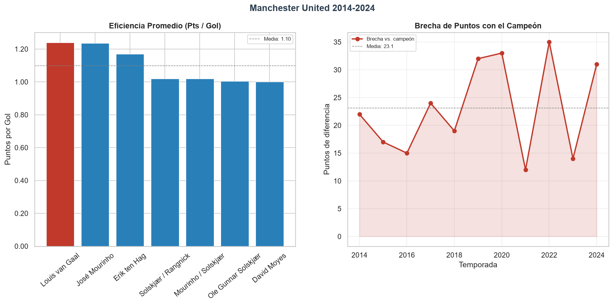

# Manchester United: What happened after Ferguson?

[](https://github.com/alvarosalinaso/manchester-united-analisis/actions/workflows/ci.yml) [](https://python.org) [](LICENSE)

---

## What is this?

EN: Everyone has an opinion about Manchester United's decline. I wanted to quantify it. This project uses three decades of Premier League final tables (2014-2024 analyzed in depth) to measure the institutional instability, the gap with champions, and how each manager performed in points per game.

ES: Todos tienen una opinión sobre el declive del Manchester United. Yo quería cuantificarlo. Este proyecto usa tres décadas de tablas finales de la Premier League (con 2014-2024 analizados en profundidad) para medir la inestabilidad institucional, la brecha con los campeones, y cómo rindió cada entrenador en puntos por partido.

---

## Questions I asked

**P1 (Competitive gap):** How many points per season does United trail the champion by on average?

**P2 (Cost of instability):** How much has United spent on firing managers in severance packages? *(Not computed in this repo, no sourced figure is claimed.)*

**P3 (Manager efficiency):** Which manager averaged the most points per game?

---

## How it works

```
data.py → load PL CSV data
analysis.py → KPIs, gap calculation, manager efficiency
causal_inference.py → descriptive before/after on managerial changes + placebo test
cohort_analysis.py → manager tenure & points stability by era
```

### Key methods

- **Before/after comparison:** Descriptive pre/post points around each managerial change (NOT causal, no control group), with placebo testing
- **Cohort analysis:** Manager tenure and points stability across eras

---

## Key findings

<!-- FIND:table -->| Metric | Value | What it means |
|--------|-------|---------------|
| Average gap to champion (2014-2024) | 23.1 pts/season | Points behind the champion on average |
| Best manager (pts/game) | José Mourinho (1.97) | Highest average PPG while in charge |
| Worst manager (pts/game) | David Moyes (1.68) | Lowest average PPG in the period |
| Cost of instability | ~7.4 pts | Points lost per transition season |<!-- /FIND:table -->

These numbers are generated by `python -m src.findings` (source of truth: `data/pl-tables-1993-2024.csv`).
The <!-- FIND:brecha -->23.1<!-- /FIND:brecha -->-point gap is the difference between title contenders and a mid-table side, meaning repeated failure to qualify for Champions League revenue.

---

## Benchmark, Premier League sin United

Average points per game of the rest of the Premier League (all 20 teams per season, United excluded), season by season.
Fuente: `data/pl-tables-1993-2024.csv` (tablas finales de la Premier League incluidas en el repositorio).

<!-- FIND:bench -->| Season | United PPG | PL avg PPG (sin United) | Δ PPG |
|--------|------------|--------------------------|-------|
| 2014 | 1.68 | 1.38 | +0.30 |
| 2015 | 1.84 | 1.35 | +0.49 |
| 2016 | 1.74 | 1.34 | +0.40 |
| 2017 | 1.82 | 1.37 | +0.45 |
| 2018 | 2.13 | 1.33 | +0.80 |
| 2019 | 1.74 | 1.39 | +0.35 |
| 2020 | 1.74 | 1.36 | +0.38 |
| 2021 | 1.95 | 1.36 | +0.59 |
| 2022 | 1.53 | 1.38 | +0.15 |
| 2023 | 1.97 | 1.35 | +0.62 |
| 2024 | 1.58 | 1.37 | +0.21 |<!-- /FIND:bench -->

---

## Pases por 90 minutos (2024-25), desde united-passing

Progressive passes (PrgP) and key passes (KP) per 90 minutes for United players with **at least 900 minutes**, computed from the FBref export vendored in `data/passing_players_2425.csv` (source: [united-passing-efficiency-24-25](https://github.com/alvarosalinaso/united-passing-efficiency-24-25)).

Percentiles are **within the United squad**: FBref blocks automated access to the full-league passing table, so league-wide percentiles are not computed here (no figures are invented). The pass network and xT are intentionally excluded.

<!-- FIND:passing -->| Jugador | Pos | 90s | PrgP/90 | KP/90 | Pctl PrgP (plantel) | Pctl KP (plantel) |
|---------|-----|-----|---------|-------|---------------------|-------------------|
| Bruno Fernandes | MF | 54.7 | 8.46 | 2.47 | 100 | 100 |
| Lisandro Martínez | DF | 30.0 | 6.13 | 0.53 | 95 | 38 |
| Casemiro | MF | 31.1 | 5.05 | 1.16 | 90 | 81 |
| Mason Mount | MF | 10.8 | 4.35 | 0.83 | 86 | 52 |
| Christian Eriksen | MF | 19.3 | 3.99 | 2.44 | 81 | 95 |
| Noussair Mazraoui | DF | 49.8 | 3.86 | 0.58 | 76 | 43 |
| Diogo Dalot | DF | 49.5 | 3.47 | 0.87 | 71 | 60 |
| Leny Yoro | DF | 22.8 | 3.25 | 0.22 | 64 | 17 |
| Patrick Dorgu | DF | 16.9 | 3.25 | 1.07 | 64 | 71 |
| Kobbie Mainoo | MF | 23.0 | 3.17 | 0.87 | 57 | 60 |
| Victor Lindelöf | DF | 13.7 | 2.85 | 0.22 | 52 | 17 |
| Amad Diallo | MF,FW | 30.6 | 2.55 | 1.99 | 48 | 90 |
| Joshua Zirkzee | FW,MF | 25.2 | 2.54 | 0.75 | 43 | 48 |
| Manuel Ugarte | MF | 32.0 | 2.47 | 0.47 | 38 | 33 |
| Harry Maguire | DF | 30.9 | 2.36 | 0.42 | 33 | 29 |
| Matthijs de Ligt | DF | 34.6 | 2.17 | 0.23 | 29 | 24 |
| Marcus Rashford | FW,MF | 16.6 | 2.05 | 1.08 | 24 | 76 |
| Alejandro Garnacho | MF,FW | 39.7 | 1.96 | 1.49 | 19 | 86 |
| Rasmus Højlund | FW | 36.8 | 0.87 | 0.95 | 14 | 67 |
| André Onana | GK | 50.7 | 0.08 | 0.02 | 10 | 10 |
| Altay Bayındır | GK | 10.3 | 0.00 | 0.00 | 5 | 5 |<!-- /FIND:passing -->

**Fuente y licencia de los datos:** FBref (temporada 2024-25). Los datos de FBref pertenecen a sus proveedores (Opta) y se usan citando la fuente según los términos de uso de FBref; **no** están cubiertos por la licencia MIT de este repositorio (el código sí lo está).

---

## Qué mide y qué no

**Mide (2014-2024, 11 temporadas):**
- Brecha de puntos y de goles vs el campeón de cada temporada.
- Puntos por partido (PPG) y puntos por gol por entrenador.
- Comparación descriptiva pre/post de cada cambio de técnico, con test placebo (semilla fija).
- Benchmark: PPG del United vs media de la Premier League sin United por temporada.
- Pases progresivos y clave por 90 minutos del plantel del United 2024-25 (mín. 900 minutos), con percentiles dentro del plantel.

**No mide:**
- No estima efectos causales de los cambios de técnico (sin grupo de control ni tendencias paralelas).
- No modela gasto de transferencias, plantilla ni valor de mercado (sin fuente fiable no se inventan cifras).
- No proyecta resultados futuros.
- No calcula percentiles de pase contra toda la Premier (FBref bloquea el acceso automatizado a la tabla completa de la liga; los percentiles publicados son internos del plantel). No incluye red de pases ni xT.

---

## Visualizations

<details>
<summary><strong>Datawrapper, PL Benchmark</strong></summary>

<div style="position:relative;padding-bottom:56.25%;height:0;overflow:hidden;max-width:100%;">
  <iframe src="https://datawrapper.dwcdn.net/vfOvM/" title="PL Benchmark" style="position:absolute;top:0;left:0;width:100%;height:100%;border:0;" loading="lazy" allowfullscreen></iframe>
</div>
</details>

## Captura



---

## Data & sources

All data lives in `data/`:

| File | Source | Notes |
|------|--------|-------|
| `data/pl-tables-1993-2024.csv` | Premier League final tables (FBref-style export) | 20 teams per season; used for gap, PPG and benchmark |
| `data/analisis_united_2014_2024.csv` | Derived from the PL tables | United-only KPIs 2014-2024 |
| `data/passing_players_2425.csv` | [FBref](https://fbref.com) export (via [united-passing-efficiency-24-25](https://github.com/alvarosalinaso/united-passing-efficiency-24-25)) | Passing stats, United squad 2024-25 |

FBref data belongs to its providers (Opta) and is used under FBref's terms of use with attribution; it is **not** covered by this repo's MIT license (the code is). The PL tables CSVs are redistributed with the same attribution requirement.

---

## How to run

```bash
git clone https://github.com/alvarosalinaso/manchester-united-analisis.git
cd manchester-united-analisis
python -m venv .venv
source .venv/bin/activate
pip install -r requirements.txt

python main.py          # pipeline completo (regenera exports y tablas del README)
python -m src.findings  # solo recalcula hallazgos y sincroniza README/dashboard
pytest                  # ruff + pytest en verde (gate de cobertura: 65%)
```

---

## Project structure

```
manchester-united-analisis/
├── data/                  # Datos (PL tables, United KPIs, FBref passing)
├── src/manutd_analysis/   # Main package (data, analysis, plots)
├── src/findings.py        # Hallazgos → README/dashboard (fuente de verdad)
├── src/benchmark_pl.py    # PL avg sin United por temporada
├── src/passing_90.py      # PrgP/90 y KP/90 (mín. 900 min)
├── src/causal_inference.py  # before/after + placebo test (semilla fija)
├── src/cohort_analysis.py   # Manager tenure & stability by era
├── tests/                 # Unit tests
└── requirements.txt
```

---

## Related projects

- [Passing Network Analysis](https://github.com/alvarosalinaso/united-passing-efficiency-24-25), Graph analysis of Man United's passing
- [Tactical Graph Theory](https://github.com/alvarosalinaso/tactical-narrative-graph-analysis), NetworkX graph visualization
- [Portfolio Web](https://github.com/alvarosalinaso/portfolio-web), Dashboard with all projects

---

> **Álvaro Salinas Ortiz**
> [LinkedIn](https://www.linkedin.com/in/alvaro-salinas-ortiz) | [Portfolio](https://alvarosalinaso.github.io/portfolio-web/)
